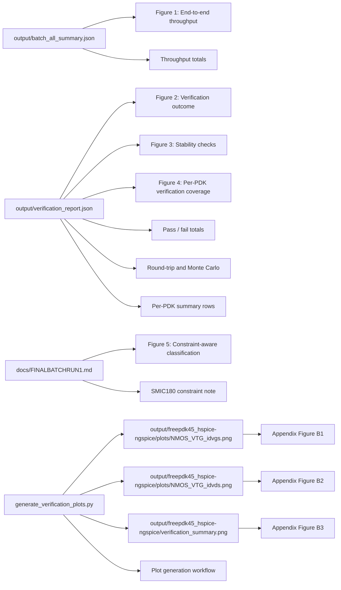

# APCCAS Figure Flow

This Mermaid figure map replaces the Visio-specific artifact sheet.

## Plot outputs to cite

- output/freepdk45_hspice-ngspice/plots/NMOS_VTG_idvgs.png
- output/freepdk45_hspice-ngspice/plots/NMOS_VTG_idvds.png
- output/freepdk45_hspice-ngspice/verification_summary.png

## Plot output locations from refreshed run

- output/freepdk45_hspice-ngspice/
- output/freepdk45_hspice-ngspice/plots/