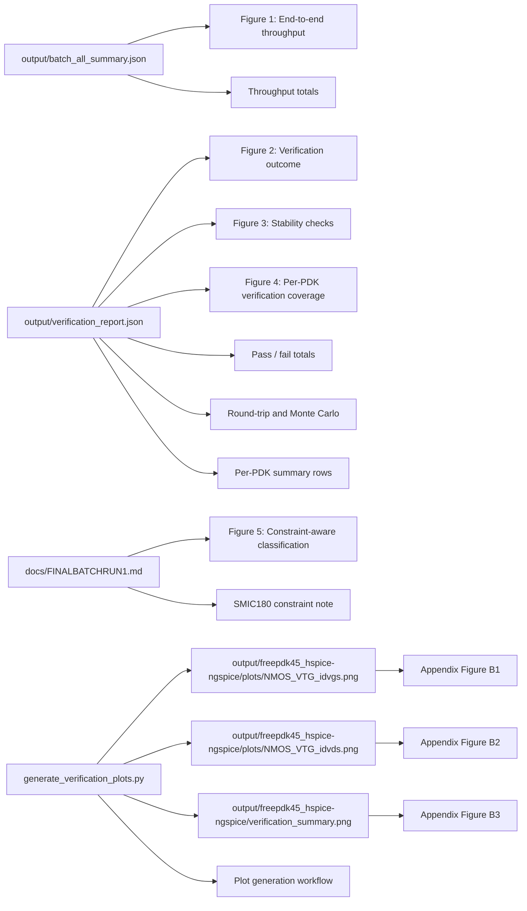

# APCCAS Paper Draft 3 (Conference-Ready Revision)

Date: April 17, 2026  
Working title: Semantic IR-Based SPICE Model Translation with Constraint-Aware Verification Across 17 PDK Families

## 4. Results

### 4.1 Experimental setup and scope

Results are reported from a clean rerun that starts from an empty output directory and executes full-batch translation followed by full-batch verification. Translation was run on 17 PDK families and verification was run on ngspice-targeted outputs from 15 PDK families.

### 4.2 Translation outcomes

The translation campaign processed diverse input styles, including wrapper-heavy HSPICE libraries, Spectre model decks, and ngspice-native sources. Final translation totals are:

- PDKs processed: 17
- Source files discovered: 322
- Translations executed: 224
- Models translated: 6638
- Plot generation in this run: disabled by design

These counts indicate broad operational coverage rather than a narrow benchmark.

### 4.3 Verification outcomes

Verification was performed on translated ngspice libraries with a multi-axis test suite (syntax, DC, AC, transient, sanity, Monte Carlo, and round-trip consistency). Aggregate results are:

- PDKs verified: 15
- Files verified: 52
- Total tests: 587
- Passed: 587
- Failed: 0
- Pass rate: 100.0%
- Round-trip consistency: 52/52
- Monte Carlo stability: 52/52

No residual failures remain in the final run.

### 4.4 Per-PDK verification summary

Table 1 reports per-PDK verification totals for ngspice-targeted outputs.

| PDK | Files | Tests | Passed | Failed |
|---|---:|---:|---:|---:|
| ASAP7 | 6 | 70 | 70 | 0 |
| Cadence14 | 5 | 47 | 47 | 0 |
| Cadence180 | 11 | 38 | 38 | 0 |
| Cadence45 | 7 | 49 | 49 | 0 |
| Cadence90 | 8 | 44 | 44 | 0 |
| FreePDK15 | 6 | 50 | 50 | 0 |
| FreePDK3 | 1 | 10 | 10 | 0 |
| FreePDK45 | 6 | 70 | 70 | 0 |
| HLMC40LP | 2 | 28 | 28 | 0 |
| HLMC55LP | 1 | 14 | 14 | 0 |
| SMIC180 | 22 | 67 | 67 | 0 |
| SMIC180HV | 14 | 58 | 58 | 0 |
| Synopsys14 | 1 | 14 | 14 | 0 |
| Synopsys28 | 1 | 14 | 14 | 0 |
| TSMC65LP | 1 | 14 | 14 | 0 |

The largest verified sets are ASAP7 and FreePDK45 at 70 tests each, followed by SMIC180 at 67 tests.

### 4.5 Figure captions for the main text

Figure 1. End-to-end translation throughput. This figure should summarize the full rerun from 17 PDK families to 224 translations and 6638 translated models.

Figure 2. Verification outcome summary. This figure should show 52 verified files, 587 total tests, 587 passes, and zero failures.

Figure 3. Stability checks. This figure should show the 52/52 round-trip result and the 52/52 Monte Carlo result as paired bars.

Figure 4. Per-PDK verification coverage. This figure should compare test counts across the 15 verified PDK families.

Figure 5. Constraint-aware classification effect. This figure should show how the verifier separates BSIM4 simulator-constraint cases from translator failures.

## 5. Discussion

### 5.1 Practical robustness across heterogeneous libraries

The main finding is robustness under heterogeneous PDK packaging. The system succeeds on flat model files and include-driven wrapper trees in the same campaign. This behavior is consistent with the intended role of ModelIR: preserve semantic model structure before dialect-specific writing.

### 5.2 Why this verification design is stronger than syntax-only checks

Syntax-only success is insufficient for compact-model portability. The reported campaign validates behavioral executability (DC, AC, transient), statistical stability (Monte Carlo), and translation stability (round-trip). The 52/52 outcomes on both Monte Carlo and round-trip indicate no observed degradation in these dimensions for the verified file set.

### 5.3 Constraint-aware BSIM4 classification

Earlier campaign iterations showed seven SMIC180 failures associated with BSIM4 geometry-envelope checks in the simulator. These were reclassified as simulator constraints when signatures matched known non-translation error patterns. This improves reporting validity by separating translator defects from simulator guardrails, and prevents inflated defect counts due to environment-side rejection.

### 5.4 Implications for deployment and research reporting

For deployment, the result indicates that the toolchain is viable for cross-simulator migration workflows across multiple industrial-style PDK families. For research reporting, the result is reproducible because both translation and verification are tied to persisted run artifacts and machine-readable summaries.

## 6. Threats to Validity

1. External validity: verification is concentrated on ngspice-targeted outputs; conclusions about target-simulator behavior should be stated with that scope.
2. Benchmark representativeness: the 17-PDK set is broad but not exhaustive across all available process/model libraries.
3. Version sensitivity: simulator and model-version updates can affect envelope checks and parser behavior.
4. Plot-free rerun mode: this final campaign disables plot generation; visual curve comparison is therefore based on prior tooling capability rather than this exact run output.

## 7. Conclusion

The final campaign translates all 17 PDK families and verifies 587/587 tests on 15 ngspice-targeted PDK outputs with zero residual failures. Combined with round-trip and Monte Carlo full-pass outcomes, the results support the claim that semantic IR translation with constraint-aware verification is a practical method for cross-simulator SPICE model portability.

## Appendix A. Mermaid Figure Map

Use the Mermaid flowchart below to describe the report figures, graph outputs, and appendix plots.

### Appendix A1. Mermaid usage notes

- Use this flowchart directly in the paper draft if you want a diagrammatic appendix.
- If you need a narrower version, remove the appendix plot nodes and keep only F1 to F5.
- The refreshed plot outputs currently live under output/freepdk45_hspice-ngspice/.

### Appendix A2. Actual refreshed plot outputs

- output/freepdk45_hspice-ngspice/verification_summary.png
- output/freepdk45_hspice-ngspice/plots/NMOS_VTG_idvgs.png
- output/freepdk45_hspice-ngspice/plots/NMOS_VTG_idvds.png
- output/freepdk45_hspice-ngspice/plots/PMOS_VTG_idvgs.png
- output/freepdk45_hspice-ngspice/plots/PMOS_VTG_idvds.png

## References

[1] L. W. Nagel, SPICE2: A computer program to simulate semiconductor circuits, University of California, Berkeley, 1975.

[2] P. W. Tuinenga, SPICE: A Guide to Circuit Simulation and Analysis Using PSpice, 2nd ed., Prentice Hall, 1995.

[3] UC Berkeley BSIM Group, BSIM4 Model documentation, latest release 4.8.3, 2025.

[4] UC Berkeley BSIM Group, BSIM-CMG Model documentation, latest release 112.0.0, 2024.

[5] ngspice project documentation and OSDI/OpenVAF support notes, official ngspice site, accessed 2026.

[6] SemiMod GmbH, OpenVAF official documentation and release pages, accessed 2026.

[7] dwarning/VA-Models, Verilog-A compact model collection, release v2.2, 2024.

[8] ngspice SourceForge project page and current project documentation, accessed 2026.

[9] Compact Model Coalition model documentation and current standards pages, accessed 2026.

[10] Sandia National Laboratories, Xyce Verilog-A and ADMS integration documentation, accessed 2026.

[11] Repository artifacts from this project, including docs/FINALBATCHRUN1.md, output/batch_all_summary.json, and output/verification_report.json, 2026.
